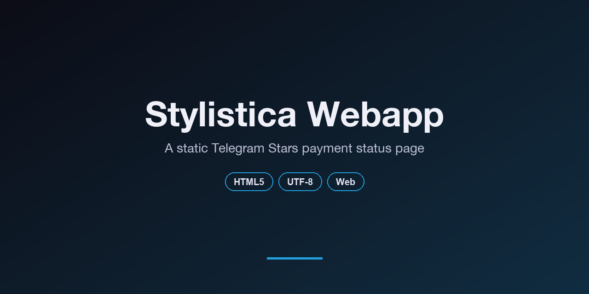
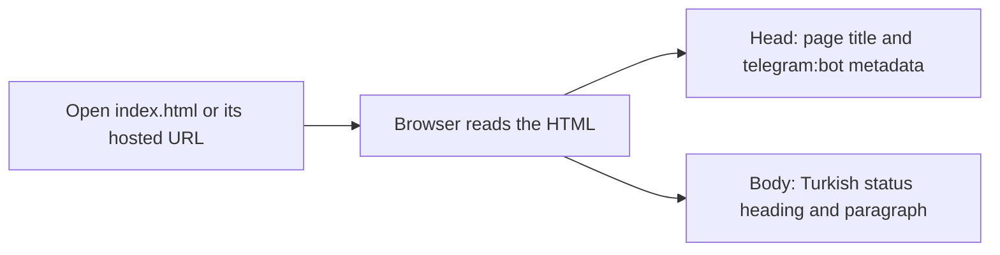

<p align="center">
  
</p>

<p align="center">
  
  
</p>

<p align="center">
  <b>A minimal status page for Stylistica's Telegram Stars setup.</b><br>
  A single HTML file identifies the bot and displays a short payment status message in Turkish.
</p>

---

## Overview

Stylistica Webapp is a static page titled "Stylistica Stars Payment". It declares `@StylisticaAI_Bot` in a `telegram:bot` meta tag and displays text stating that Telegram has verified the page and the Stars payment setup is working. These are fixed messages in the HTML; the page does not check verification or process payments.

## Features

- **Bot metadata.** Associates the page with `@StylisticaAI_Bot` through the HTML head.
- **Turkish status text.** Shows a heading and paragraph about the Telegram Stars setup.
- **Static delivery.** Uses plain HTML with UTF-8 encoding and no scripts, stylesheets, or package dependencies.

## How it works



## Tech stack

| Component | Implementation |
|---|---|
| Page | HTML5 with UTF-8 encoding |
| Bot association | `telegram:bot` meta tag |
| Runtime | Web browser |
| Build | None required |

## Getting started

```bash
git clone https://github.com/rcemkarhan/stylistica-webapp.git
cd stylistica-webapp
```

Open `index.html` in a web browser. On macOS:

```bash
open index.html
```

Edit `index.html` and reload the browser to see changes. To publish the page, serve that file through a static web host. The repository includes no deployment configuration or automated test commands.

## Project structure

```text
stylistica-webapp/
├── .github/assets/    README banner
├── index.html        Bot metadata and Turkish status text
└── README.md         Project documentation
```
